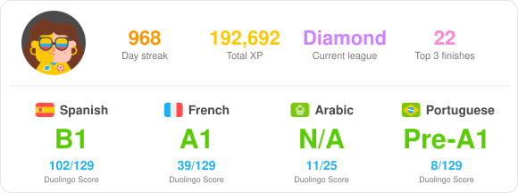

# Duolingo CEFR badge

<picture>
  <source media="(prefers-color-scheme: dark)" srcset="duolingo-dark.svg">
  
</picture>

A daily GitHub Action fetches your Duolingo profile and courses and renders `duolingo.svg`. The top row shows your avatar, total XP and number of top 3 leaderboard finishes. Below it is every language with a Duolingo Score of 7 or higher:

- **CEFR level**: level of the last fully completed path section (`Pre-A1` if none yet, `N/A` for courses not aligned to CEFR).
- **Duolingo Score**: current score out of the course maximum.

## Setup

1. Log in at duolingo.com and copy the `jwt_token` cookie (DevTools > Application > Cookies).
2. Save it as the Actions secret `DUOLINGO_JWT`.
3. Run the **Update Duolingo badge** workflow (or wait for the daily run).

The README shows the badge matching your GitHub theme. To embed elsewhere (e.g. your profile README):

```html
<picture>
  <source media="(prefers-color-scheme: dark)" srcset="https://raw.githubusercontent.com/Samantha-norrie/duolingo-cefr-badge/main/duolingo-dark.svg">
  
</picture>
```

Flags in `assets/flags/` are Duolingo's own course flag artwork (copied from duolingo.com), named by language code.
